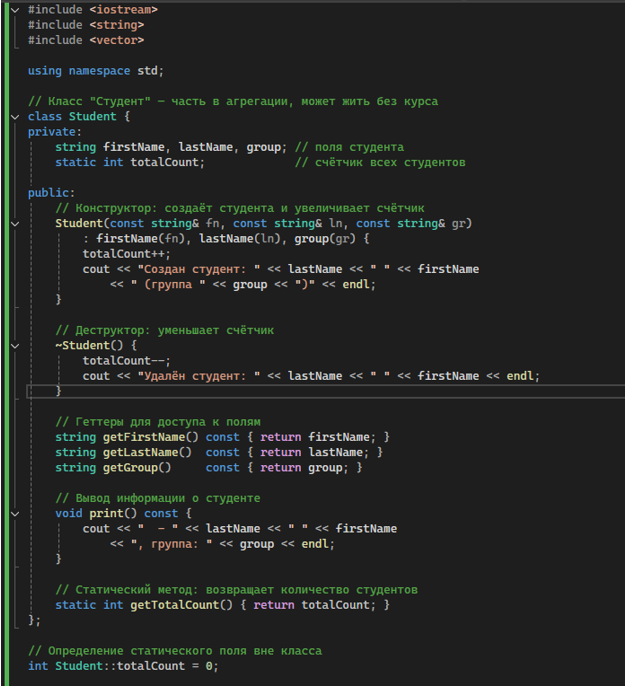
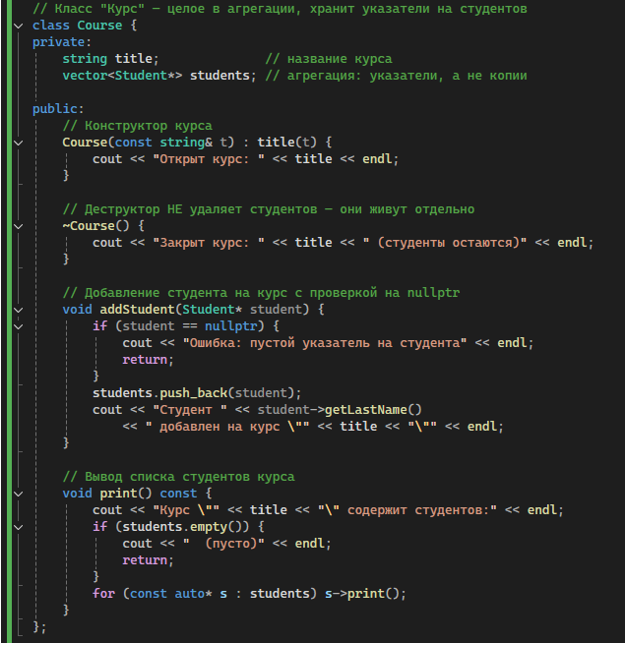
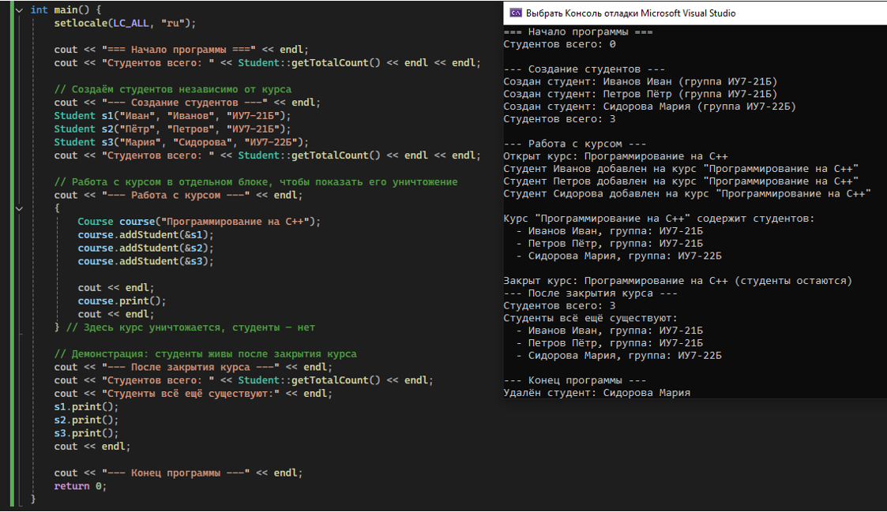

МИНИСТЕРСТВО НАУКИ И ВЫСШЕГО ОБРАЗОВАНИЯ РОССИЙСКОЙ ФЕДЕРАЦИИ
Федеральное государственное автономное образовательное учреждение высшего образования
«СЕВЕРО-КАВКАЗСКИЙ ФЕДЕРАЛЬНЫЙ УНИВЕРСИТЕТ»
Институт перспективной инженерии
Департамент цифровых, робототехнических систем и электроники
Межинститутская базовая кафедра

# Отчет по лабораторной работе № 1

**Вариант 3**

**Тема:** «Композиция и агрегация классов. Статические члены»
**Дисциплина:** «Алгоритмы и структуры данных»

**Выполнил:**
Студент группы ПИЖ-б-о-25-1 (1),
направление подготовки: 09.03.04 «Программная инженерия»
Алейникова Юлия Андреевна

**Проверила:**
Ассистент межинститутской базовой кафедры ДЦРСиЭ
Белик Ангелина Игоревна

Ставрополь 2026

---

## 1. Цели работы

1. Научиться проектировать отношения между классами: композицию, агрегацию и ассоциацию.
2. Освоить реализацию композиции (поля-объекты, вложение структур) и агрегации (указатели, ссылки).
3. Понять разницу между композицией и агрегацией с точки зрения времени жизни объектов.
4. Научиться использовать статические поля и методы для подсчёта объектов и реализации общих данных для всех экземпляров класса.
5. Получить навыки правильного управления памятью при разных типах отношений между классами.

## 2. Индивидуальное задание

**Средний уровень**

**Общее задание:** Реализовать два класса, связанных отношением агрегация (часть может существовать без целого). Добавить статическое поле для подсчёта количества объектов класса «Часть». Продемонстрировать, что при уничтожении целого части продолжают существовать.


### Решение

```cpp
#include <iostream>
#include <string>
#include <vector>

using namespace std;

// Класс "Студент" – часть в агрегации, может жить без курса
class Student {
private:
    string firstName, lastName, group; // поля студента
    static int totalCount;             // счётчик всех студентов

public:
    // Конструктор: создаёт студента и увеличивает счётчик
    Student(const string& fn, const string& ln, const string& gr)
        : firstName(fn), lastName(ln), group(gr) {
        totalCount++;
        cout << "Создан студент: " << lastName << " " << firstName
             << " (группа " << group << ")" << endl;
    }

    // Деструктор: уменьшает счётчик
    ~Student() {
        totalCount--;
        cout << "Удалён студент: " << lastName << " " << firstName << endl;
    }

    // Геттеры для доступа к полям
    string getFirstName() const { return firstName; }
    string getLastName() const { return lastName; }
    string getGroup() const { return group; }

    // Вывод информации о студенте
    void print() const {
        cout << " - " << lastName << " " << firstName
             << ", группа: " << group << endl;
    }

    // Статический метод: возвращает количество студентов
    static int getTotalCount() { return totalCount; }
};

// Определение статического поля вне класса
int Student::totalCount = 0;

class Course {
private:
    string title;
    vector<Student*> students;

public:
    // Конструктор курса
    Course(const string& t) : title(t) {
        cout << "Открыт курс: " << title << endl;
    }

    // Деструктор НЕ удаляет студентов – они живут отдельно
    ~Course() {
        cout << "Закрыт курс: " << title << " (студенты остаются)" << endl;
    }

    // Добавление студента на курс с проверкой на nullptr
    void addStudent(Student* student) {
        if (student == nullptr) {
            cout << "Ошибка: пустой указатель на студента" << endl;
            return;
        }
        students.push_back(student);
        cout << "Студент " << student->getLastName() << " " << student->getFirstName()
             << " добавлен на курс \"" << title << "\"" << endl;
    }

    // Вывод списка студентов курса
    void print() const {
        cout << "Курс \"" << title << "\" содержит студентов:" << endl;
        if (students.empty()) {
            cout << " (пусто)" << endl;
            return;
        }
        for (const auto* s : students) s->print();
    }
};

int main() {
    setlocale(LC_ALL, "ru");

    cout << "=== Начало программы ===" << endl;
    cout << "Студентов всего: " << Student::getTotalCount() << endl << endl;

    // Создаём студентов независимо от курса
    cout << "=== Создание студентов ===" << endl;
    Student s1("Иванов", "Иван", "ИУ-21Б");
    Student s2("Петров", "Пётр", "ИУ-21Б");
    Student s3("Сидорова", "Мария", "ИУ-22Б");
    cout << "Студентов всего: " << Student::getTotalCount() << endl << endl;

    // Работа с курсом в отдельном блоке, чтобы показать его уничтожение
    cout << "=== Работа с курсом ===" << endl;
    {
        Course course("Программирование на C++");
        course.addStudent(&s1);
        course.addStudent(&s2);
        course.addStudent(&s3);

        cout << endl;
        course.print();
        cout << endl;
    } // Здесь курс уничтожается, студенты – нет

    // Демонстрация: студенты живы после закрытия курса
    cout << "=== После закрытия курса ===" << endl;
    cout << "Студентов всего: " << Student::getTotalCount() << endl;
    cout << "Студенты всё ещё существуют:" << endl;
    s1.print();
    s2.print();
    s3.print();
    cout << endl;

    cout << "=== Конец программы ===" << endl;
    return 0;
}
```

### Результаты работы программы

```text
=== Начало программы ===
Студентов всего: 0

=== Создание студентов ===
Создан студент: Иванов Иван (группа ИУ-21Б)
Создан студент: Петров Пётр (группа ИУ-21Б)
Создан студент: Сидорова Мария (группа ИУ-22Б)
Студентов всего: 3

=== Работа с курсом ===
Открыт курс: Программирование на C++
Студент Иванов Иван добавлен на курс "Программирование на C++"
Студент Петров Пётр добавлен на курс "Программирование на C++"
Студент Сидорова Мария добавлен на курс "Программирование на C++"

Курс "Программирование на C++" содержит студентов:
 - Иванов Иван, группа: ИУ-21Б
 - Петров Пётр, группа: ИУ-21Б
 - Сидорова Мария, группа: ИУ-22Б

Закрыт курс: Программирование на C++ (студенты остаются)

=== После закрытия курса ===
Студентов всего: 3
Студенты всё ещё существуют:
 - Иванов Иван, группа: ИУ-21Б
 - Петров Пётр, группа: ИУ-21Б
 - Сидорова Мария, группа: ИУ-22Б

=== Конец программы ===
Удалён студент: Сидорова Мария
Удалён студент: Петров Пётр
Удалён студент: Иванов Иван
```



Рисунок 1 – Программа задания.



Рисунок 2 – Программа задания(продолжение 1).



Рисунок 3 – Программа задания(продолжение 2).


**Ссылка на GitHub:** https://github.com/aiilluj/algorithm.git

## 3. Контрольные вопросы

**1. Что такое композиция? Приведите пример.**
Композиция – отношение «часть–целое», при котором часть не может существовать без целого. Целое управляет временем жизни частей: создаёт и удаляет их вместе с собой. Пример: класс `House` и класс `Room` – комнаты создаются внутри дома и уничтожаются вместе с ним.

**2. Что такое агрегация? Чем она отличается от композиции?**
Агрегация – отношение «часть–целое», при котором часть может существовать независимо от целого и принадлежать нескольким целым. Отличие от композиции: при агрегации часть не удаляется вместе с целым, создаётся отдельно, а целое хранит лишь указатели или ссылки на неё. Пример: `Library` и `Book`.

**3. Как реализовать композицию в C++? Приведите пример кода.**
Композиция реализуется полем-объектом, указателем с ручным удалением или `unique_ptr`. Пример:
```cpp
class House {
    Room livingRoom;
    Room kitchen;
public:
    House() : livingRoom(25, "Гостиная"), kitchen(10, "Кухня") {}
};
```
Здесь комнаты создаются и удаляются автоматически вместе с домом.

**4. Как реализовать агрегацию в C++? Приведите пример кода.**
Агрегация реализуется хранением указателей или ссылок, без удаления в деструкторе. Пример:
```cpp
class Library {
    vector<Book*> books;
public:
    void addBook(Book* b) { if (b) books.push_back(b); }
    // деструктор книги НЕ удаляет
};
```

**5. В чём разница между временем жизни частей при композиции и агрегации?**
При композиции время жизни части не превышает время жизни целого – часть умирает вместе с ним. При агрегации часть может быть создана до целого, существовать после его уничтожения и принадлежать нескольким целым.

**6. Что такое статическое поле класса? Чем оно отличается от обычного поля?**
Статическое поле принадлежит всему классу, а не отдельному объекту, и существует в единственном экземпляре. Отличие от обычного: обычное поле своё у каждого объекта, статическое – общее для всех, доступно через имя класса.

**7. Как объявить и определить статическое поле? Где оно хранится?**
Объявление – внутри класса со словом `static`, определение – обязательно вне класса:
```cpp
class Student { static int count; };
int Student::count = 0;
```
Хранится в статической области памяти и существует всё время работы программы.

**8. Что такое статический метод? Можно ли из него обратиться к нестатическим полям?**
Статический метод принадлежит классу и вызывается без создания объекта. Из него нельзя обратиться к нестатическим полям напрямую, так как нет указателя `this` – только к статическим.

**9. Для чего используются статические счётчики объектов?**
Для подсчёта созданных объектов класса, отслеживания текущего количества живых объектов, сбора общей статистики и ограничения числа экземпляров. Увеличивается в конструкторе, уменьшается в деструкторе.

**10. Что такое паттерн «Одиночка» (Singleton)? Для чего он нужен?**
Singleton – порождающий паттерн, гарантирующий наличие только одного экземпляра класса и предоставляющий глобальную точку доступа к нему. Нужен, когда в системе должен быть ровно один объект (логгер, менеджер конфигурации, единственная компания).

**11. Как запретить создание копий объекта (конструктор копирования)?**
Удалить конструктор копирования и оператор присваивания через `= delete`:
```cpp
Singleton(const Singleton&) = delete;
Singleton& operator=(const Singleton&) = delete;
```
Попытка копирования вызовет ошибку компиляции.

**12. В каком порядке вызываются конструкторы и деструкторы при композиции?**
Конструкторы – в порядке объявления полей в классе. Деструкторы – в обратном порядке: сначала части, потом само целое. То есть конструкторы сверху вниз, деструкторы снизу вверх.

**13. Можно ли изменить статическое поле из обычного метода?**
Да, можно. Обычный метод имеет доступ и к своим, и к статическим полям класса. Ограничение только обратное: из статического метода нельзя обратиться к нестатическим полям.

**14. Почему статические поля нужно определять вне класса?**
Потому что объявление в классе – только декларация, а не выделение памяти. Если определить поле в классе, при подключении заголовка в несколько `.cpp`-файлов возникнет ошибка множественного определения. Определение должно быть одно на всю программу.

**15. В каких случаях стоит использовать композицию, а в каких – агрегацию?**
Композицию – когда часть не имеет смысла без целого, целое владеет частью и контролирует её жизненный цикл. Агрегацию – когда часть может существовать независимо, входить в несколько целых, и целое не должно её удалять. Правило: кто удаляет часть – тот и владелец.

## 4. Вывод

Научились проектировать отношения между классами: композицию, агрегацию и ассоциацию. Освоили реализацию композиции (поля-объекты, вложение структур) и агрегации (указатели, ссылки). Поняли разницу между композицией и агрегацией с точки зрения времени жизни объектов. Научились использовать статические поля и методы для подсчёта объектов и реализации общих данных для всех экземпляров класса. Получили навыки правильного управления памятью при разных типах отношений между классами.