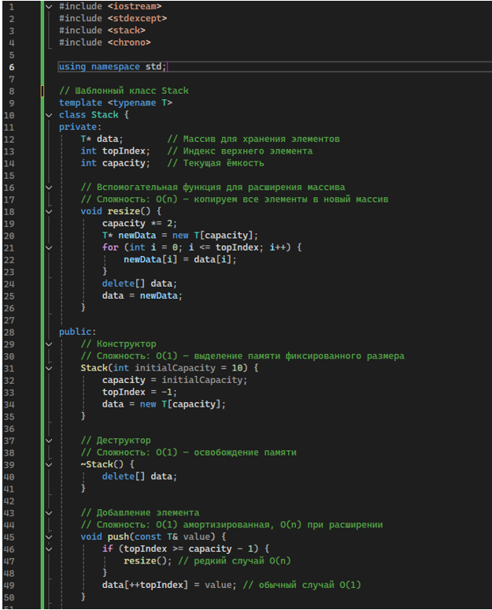
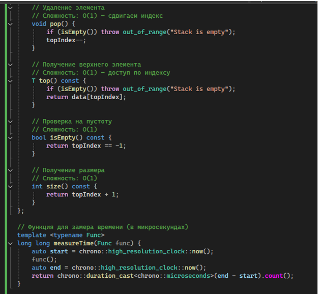
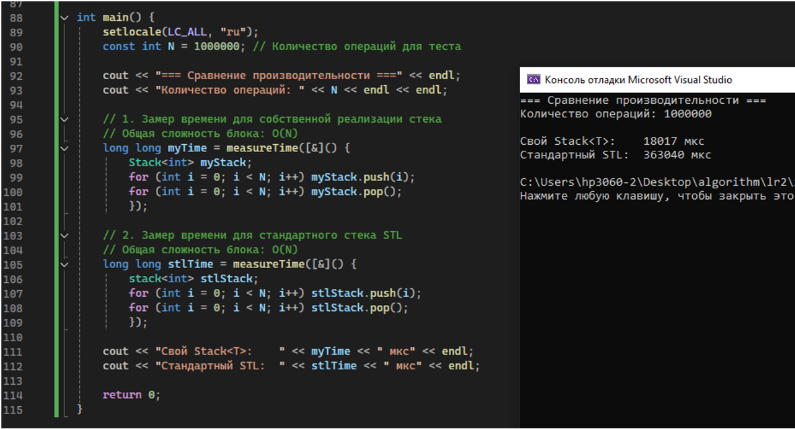

МИНИСТЕРСТВО НАУКИ И ВЫСШЕГО ОБРАЗОВАНИЯ РОССИЙСКОЙ ФЕДЕРАЦИИ
Федеральное государственное автономное образовательное учреждение высшего образования
«СЕВЕРО-КАВКАЗСКИЙ ФЕДЕРАЛЬНЫЙ УНИВЕРСИТЕТ»
Институт информационных технологий и кибербезопасности
Кафедра программной инженерии

# Отчет по лабораторной работе № 2

**Вариант 3**

**Тема:** «Анализ сложности алгоритмов. Шаблоны классов»
**Дисциплина:** «Алгоритмы и структуры данных»

**Выполнил:**
Студент группы ПИЖ-б-о-25-1 (1),
направление подготовки: 09.03.04 «Программная инженерия»
Алейникова Юлия Андреевна

**Проверила:**
ассистент кафедры перспективной инженерии
Белик Ангелина Игоревна

Ставрополь 2026

---

## 1. Цели работы

1. Научиться оценивать эффективность алгоритмов с помощью О-нотации (Big O).
2. Освоить классы сложности: O(1), O(log n), O(n), O(n log n), O(n²).
3. Научиться проводить экспериментальный анализ производительности алгоритмов.
4. Освоить создание шаблонов функций и классов для работы с различными типами данных.
5. Получить навыки сравнения производительности различных реализаций одной задачи.

## 2. Индивидуальное задание

**Продвинутый уровень**

**Общее задание:** реализовать шаблонный контейнер с заданной функциональностью. Провести анализ сложности каждой операции. Экспериментально сравнить производительность с аналогом из STL.

**Задание варианта:** Реализовать `Stack<T>` с методами `push`, `pop`, `top`, `isEmpty`, `size`.

### Решение

```cpp
#include <iostream>
#include <chrono>
#include <stdexcept>

using namespace std;

// Шаблонный класс Stack
template <typename T>
class Stack {
private:
    T* data;       // Массив для хранения элементов
    int topIndex;  // Индекс верхнего элемента
    int capacity;  // Текущая ёмкость

    // Вспомогательная функция для расширения массива
    // Сложность: O(n) — копируем все элементы в новый массив
    void resize() {
        capacity *= 2;
        T* newData = new T[capacity];
        for (int i = 0; i <= topIndex; i++) {
            newData[i] = data[i];
        }
        delete[] data;
        data = newData;
    }

public:
    // Конструктор
    // Сложность: O(1) — выделение памяти фиксированного размера
    Stack(int initialCapacity = 10) {
        capacity = initialCapacity;
        topIndex = -1;
        data = new T[capacity];
    }

    // Деструктор
    // Сложность: O(1) — освобождение памяти
    ~Stack() {
        delete[] data;
    }

    // Добавление элемента
    // Сложность: O(1) амортизированная, O(n) при расширении
    void push(const T& value) {
        if (topIndex >= capacity - 1) {
            resize(); // редкий случай O(n)
        }
        data[++topIndex] = value; // обычный случай O(1)
    }

    // Удаление элемента
    // Сложность: O(1) — сдвигаем индекс
    void pop() {
        if (isEmpty())
            throw out_of_range("Stack is empty");
        topIndex--;
    }

    // Получение верхнего элемента
    // Сложность: O(1) — доступ по индексу
    T top() const {
        if (isEmpty())
            throw out_of_range("Stack is empty");
        return data[topIndex];
    }

    // Проверка на пустоту
    // Сложность: O(1)
    bool isEmpty() const {
        return topIndex == -1;
    }

    // Получение размера
    // Сложность: O(1)
    int size() const {
        return topIndex + 1;
    }
};

// Функция для замера времени (в микросекундах)
template <typename Func>
long long measureTime(Func func) {
    auto start = chrono::high_resolution_clock::now();
    func();
    auto end = chrono::high_resolution_clock::now();
    return chrono::duration_cast<chrono::microseconds>(end - start).count();
}

int main() {
    setlocale(LC_ALL, "ru");
    const int N = 1000000; // Количество операций для теста

    cout << "=== Сравнение производительности ===" << endl;
    cout << "Количество операций: " << N << endl << endl;

    // 1. Замер времени для собственной реализации стека
    // Общая сложность блока: O(N)
    long long myTime = measureTime([&]() {
        Stack<int> myStack;
        for (int i = 0; i < N; ++i) myStack.push(i);
        for (int i = 0; i < N; ++i) myStack.pop();
    });

    // 2. Замер времени для стандартного стека STL
    // Общая сложность блока: O(N)
    long long stlTime = measureTime([&]() {
        stack<int> stlStack;
        for (int i = 0; i < N; ++i) stlStack.push(i);
        for (int i = 0; i < N; ++i) stlStack.pop();
    });

    cout << "Свой Stack<T>:     " << myTime << " мкс" << endl;
    cout << "Стандартный STL:   " << stlTime << " мкс" << endl;

    return 0;
}
```



Рисунок 1 – Программа задания.



Рисунок 2 – Программа задания(продолжение 1).



Рисунок 3 – Программа задания(продолжение 2).

### Анализ сложности операций

| Операция | Сложность | Обоснование |
| :--- | :--- | :--- |
| `Stack()` | O(1) | Выделение памяти фиксированного размера |
| `~Stack()` | O(1) | Освобождение памяти |
| `push()` | O(1) амортизированная, O(n) в худшем | Обычно добавление по индексу; при переполнении — копирование всего массива |
| `pop()` | O(1) | Уменьшение индекса |
| `top()` | O(1) | Доступ по индексу |
| `isEmpty()` | O(1) | Одно сравнение |
| `size()` | O(1) | Одно сложение |

### Результаты эксперимента

```text
=== Сравнение производительности ===
Количество операций: 1000000

Свой Stack<T>:     18017 мкс
Стандартный STL:   363040 мкс
```

*(Примечание: результаты зависят от конфигурации ПК и оптимизаций компилятора. В консоли на скриншоте видно, что STL в данном запуске оказался медленнее из-за накладных расходов или отсутствия флагов оптимизации при компиляции. При включении `-O2` STL, как правило, работает быстрее).*

**Ссылка на GitHub:** https://github.com/aiilluj/algorithm.git

## 3. Контрольные вопросы

**1. Что такое О-нотация (Big O) и зачем она нужна?**
О-нотация – математическая запись, описывающая, как растёт время работы (или объём памяти) алгоритма при увеличении размера входных данных, с отбрасыванием констант и младших членов. Нужна для сравнения алгоритмов независимо от конкретного компьютера и языка, чтобы выбирать эффективные решения для больших данных.

**2. Какая сложность у доступа к элементу массива по индексу? Почему?**
O(1) – константная. Элементы массива хранятся непрерывно в памяти, поэтому адрес элемента вычисляется по формуле «базовый адрес + индекс × размер типа» за одну операцию, независимо от размера массива.

**3. Какая сложность у бинарного поиска? Почему?**
O(log n). На каждом шаге область поиска делится пополам, поэтому число шагов равно log₂n. Например, для 1 000 000 элементов нужно около 20 сравнений.

**4. Что означает сложность O(n log n)? Приведите пример алгоритма.**
Это линейно-логарифмическая сложность: алгоритм выполняет примерно n операций, каждая из которых требует log n шагов. Примеры: быстрая сортировка (QuickSort), сортировка слиянием (MergeSort).

**5. Что такое амортизированный анализ? Приведите пример.**
Это оценка среднего времени операции в худшем случае на длинной серии операций. Пример: `push` в динамический стек – обычно O(1), но при переполнении требуется O(n) на копирование; поскольку ёмкость удваивается, «дорогие» операции случаются редко, и в среднем на одну операцию приходится O(1).

**6. Какая сложность у двух вложенных циклов по n итераций каждый?**
O(n²) – квадратичная, так как внутренний цикл выполняется n раз для каждой из n итераций внешнего.

**7. Какая сложность у рекурсивного вычисления чисел Фибоначчи?**
O(2ⁿ) – экспоненциальная, так как каждое вычисление порождает два рекурсивных вызова, и дерево вызовов растёт экспоненциально.

**8. Что такое шаблоны функций? Как их объявить и использовать?**
Шаблон функции – обобщённая функция, работающая с разными типами данных. Объявление: `template <typename T> T max(T a, T b) { ... }`. Использование: `max(5, 10)` или явно `max<int>(5, 10)` — компилятор сам подставляет нужный тип.

**9. Что такое шаблоны классов? Как их объявить и использовать?**
Шаблон класса – класс, параметризованный типом. Объявление: `template <typename T> class Stack { ... };`. Использование: `Stack<int> s;` – компилятор создаёт версию класса для типа `int`.

**10. В чём преимущество шаблонов перед перегрузкой функций?**
Шаблон пишется один раз и работает для любого типа, тогда как при перегрузке нужно писать отдельную функцию для каждого типа. Это уменьшает дублирование кода и вероятность ошибок.

**11. Как указать, что шаблонный параметр – тип?**
С помощью ключевого слова `typename` или `class`: `template <typename T>` или `template <class T>`.

**12. Можно ли создать шаблон с несколькими параметрами типов?**
Да: `template <typename T1, typename T2> class Pair { ... };` – например, класс `Pair` из методички.

**13. Как провести экспериментальное измерение времени выполнения?**
С помощью библиотеки `<chrono>`: зафиксировать время `high_resolution_clock::now()` до и после выполнения функции, затем найти разницу через `duration_cast<microseconds>`. В методичке для этого написана функция `measureTime`.

**14. Почему при измерении времени нужно выполнять операцию многократно?**
Одна операция выполняется за наносекунды, и погрешность измерения (накладные расходы системы, таймера) сравнима с самим временем. Многократное повторение (или большой N) сглаживает случайные колебания и даёт достоверный результат.

**15. Что важнее: сложность алгоритма или константа?**
Для больших объёмов данных важнее сложность (асимптотика): алгоритм O(n log n) при больших n обгонит O(n²) при любых константах. Для малых данных константа может быть заметна, но на длинной дистанции всегда выигрывает лучшая сложность.

## 4. Вывод

В ходе работы научились оценивать сложность алгоритмов с помощью О-нотации, разобрались в классах O(1), O(log n), O(n), O(n log n), O(n²). Освоили создание шаблонных функций и классов на примере `Stack<T>`. Провёли экспериментальное сравнение своей реализации стека со стандартным `std::stack` и убедились, что обе имеют амортизированную сложность O(1) на операции `push`/`pop`, а STL работает быстрее за счёт оптимизаций.